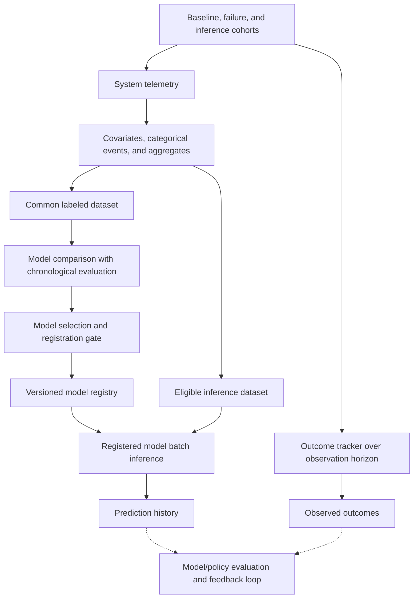

# Chip Health Forecasting: Data and ML Pipeline Design

Cloud infrastructure relies on large fleets of CPUs and GPUs deployed at scale. Systems can run multiple varied workloads, making fleet reliability and operational performance critical to maintain. However, chip health degradation can gradually reduce reliability, resulting in system interruptions, errors, and silent data corruption. Early warning for these failures creates an opportunity to intervene, move workloads, or schedule maintenance rather than react to an outage.

The challenge is that failures are rare and associated signals may be subtle, intermittent, missing, or non-specific. Server hardware differences or incomplete telemetry make it difficult to identify genuine degradation from normal variation or to attribute a system-wide failure to a specific chip. Furthermore, chip degradation accumulates over time, with small inconsistencies aggregating until a critical point when the system experiences rapid failure.

Therefore, predictive maintenance is best thought of as continuous risk-based forecasting, not as a discrete point-in-time prescriptions. The value of risk-based predictive forecasting lies in providing reliable, balanced, and historically-aware estimates of risk. The data and ML workflow below supports this goal via time-aware evaluation, uncertainty, and providing interpretable forecasts.

## 1. Design goals

- Create a common data preparation pipeline across experiments and inference.
- Compare baselines and candidate models on the same data and chronological evaluation windows.
- Keep raw risk scores, uncertainty, and decision policy as modular operations.
- Keep metadata for registered models traceable to inputs.
- Evaluate outcomes only after an observation horizon has completed.

## 2. End-to-end architecture

The workflow keeps data preparation, model experimentation, registration, inference, and post-inference policies as modular operations. Separating these stages allows for reproducibility, traceability, and auditability. For example, experiments can be repeated without affecting registered models and data can be extended independently of registered model inference.

## 3. Data preparation decisions

### 3.1 Common data preparation pipeline

The common data pipeline transforms raw telemetry into covariates, categorical events, and aggregates. A common approach ensures consistent feature extraction for both experiments and inference, allowing for reproducibility and the ability to compare different modeling approaches.

### 3.2 Data preservation for raw and transformed telemetry

Raw telemetry is preserved alongside the transformed features used for modeling. This allows for recomputation of features or alternative calculations if needed and provides a complete record of the original data. Retaining this data ensures that feature engineering can be revisited.

### 3.3 Dataset versioning

Datasets produced by the common data preparation pipeline are versioned to keep track of individual data assets. The dataset version captures the raw data inputs, transformations, and engineered features. This ensures that experiments and inference can be traced back to the exact dataset used to train a model.

## 4. Model comparison decisions

### 4.1 Chronological evaluation windows

Model comparison uses a common dataset to evaluate candidate models. Data is partitioned into a single, earlier training window followed by multiple later evaluation segments. Evaluation segments are non-overlapping, consecutive, and are defined by calendar dates instead of row counts. 

Preprocessing is fitted only on the training data. Neural estimators use an internal training subset for early stopping. 

**Caveat:** Chronological partitioning alone does not enforce disjoint system-level evaluation or resolve label overlap between systems days apart. In our experiments, data and inference cohorts were randomly sampled and defined on a rotating basis, so system-level overlap between evaluation windows was not a factor. Future work may choose to keep the first system record when there are multiple across evaluation windows. In our workflow, evaluation records report distinct system identifiers separately from distinct rows to make any overlaps between data partitions clear.

### 4.2 Aggregate, temporal, and class-level evidence

Ranking uses an aggregate macro F1 to compare models so that the majority cohort does not influence the entire score. Evaluation segment scores are combined using support-weighted averaging. The worst-performing evaluation score breaks ties and is reported alongside the aggregate score. In addition, per-class rankings are reported and weighted by support. Temporal and class-level evidence is also reported to capture nuances in model performance. Weak performance in later evaluation segments or for a particular label are made clear.

### 4.3 Separate uncertainty and actionability

Uncertainty and actionability are treated independently. Uncertainty uses prediction probabilities, entropy-based measures, and category affinities to define notions of confidence and ambiguity. Actionability considers allocation limits, priority ranking, and other post-deployment-specific policy configurations. Uncertainty and actionability are defined separately because they address two different concepts: theoretical uncertainty versus post-deployment constraints.

**Caveats:** Allocation limits constrain volume, not necessarily false positives or precision, and capped predictions are still retained in prediction history with actionability status and priority ranking.

## 5. Registration decisions

### 5.1 Evidence-based acceptance gates

Only candidate models that satisfy the acceptance criteria, listed below, for specified evaluation segments can be registered. Acceptance criteria is defined in a configuration file and is kept explicit.

- Predictive quality must be above a configured minimum.
- Coverage of predictions not flagged as uncertain remains above a configured minimum.
- A valid uncertainty policy is available and is consistent with an evaluation record.

Invalid or inconsistent evidence blocks registration. Acceptance gates use evaluation reports, however, they do not certify live performance or validate a deployment.

### 5.2 Bundled model and metadata

Each registered bundle contains the fitted pipeline, feature ordering, label mapping, configurations, evaluation metrics, uncertainty policy, provenance, acceptance evidence, and custom code. The model registry versions uploaded bundles. The bundle excludes datasets and row-level predictions. Bundled models and metadata creates traceability and reproducibility for registered models serving inference. 

## 6. Outcome evaluation

### 6.1 Multiple model inference

Registered inference resolves and downloads each selected model once. Bundle/model hashes are verified against registry metadata. Each model runs in a new subprocess using its deserialized estimator and runs inference against a single cohort shared between all models. This approach allows for multiple model implementations to run in parallel without affecting other estimators.

### 6.2 Separate prediction history and outcomes

For each prediction, the inference outcomes tracker maintains one row per complete observation horizon. The first observed failure per inference updates the outcomes tracker with the details of the failure. In the case of simultaneous failures, a priority ranking breaks ties. The observed failure is also persisted for subsequent recorded horizons. This approach lets late-arriving data update the outcome tracker without creating duplicate records and to calculate lead-time to failure for inferences.

## 7. Known limitations

Several limitations remain. First, chronological partitions do not ensure that systems or label windows do not overlap across validation segments. Moreover, current telemetry is not guaranteed to align with historical data. Finally, policies and validation improve deployment consistency but cannot guarantee performance or stability as data change. Operations outside the scope of this description, but nevertheless are important aspects of data and ML pipeline engineering, are automatic model retraining and registration, observability and alerting, and
intervention-aware labels, which are left as future work.
